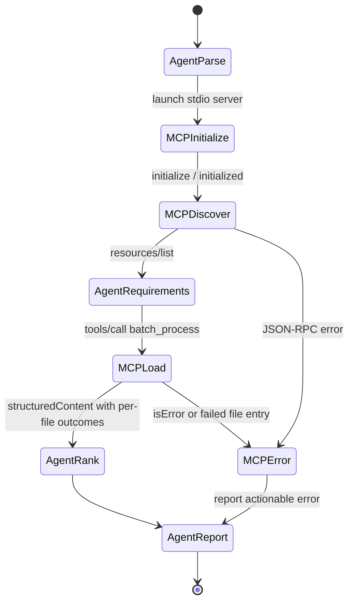

# MCP workflow and scenarios

## Agent ↔ MCP state machine



The server uses newline-delimited JSON-RPC 2.0 over stdin/stdout. `initialize`
negotiates the MCP protocol and advertises tool and resource capabilities.
`resources/list` discovers resume URIs; `resources/read` reads one resource;
`tools/list` discovers callable operations; `tools/call` invokes them. The
matching agent discovers resources, sends their paths to `batch_process`, then
scores the returned text in LangGraph nodes. `RESUME_MCP_ROOT` sets the allowed
directory (default `data/resumes`); resolved paths outside it are rejected.

## Test scenarios

Run the server with a temporary or sample resume directory:

```sh
RESUME_MCP_ROOT=data/resumes python filesystem_mcp_server.py
```

Send one JSON object per line. Example discovery sequence:

```json
{"jsonrpc":"2.0","id":1,"method":"initialize","params":{"protocolVersion":"2025-03-26","capabilities":{},"clientInfo":{"name":"manual-test","version":"1"}}}
{"jsonrpc":"2.0","method":"notifications/initialized"}
{"jsonrpc":"2.0","id":2,"method":"resources/list"}
{"jsonrpc":"2.0","id":3,"method":"tools/list"}
```

Expected: initialize returns server information and capabilities; resource
discovery returns a URI for each supported resume; tool discovery lists
`read_file`, `list_files`, `write_file`, `search_in_file`, `batch_process`, and
`watch_directory`.

1. **Read resource:** Call `resources/read` with one URI returned by
   `resources/list`. Expect extracted text as a text resource. Try a nonexistent
   URI and expect a JSON-RPC error response.
2. **Batch processing:** Call `tools/call` with name `batch_process` and a
   `filepaths` array containing two valid resumes and one missing file. Expect
   `processed: 3`, two successes, one failure, and each result preserved.
3. **Search:** Call `search_in_file` with a known skill and expect matching
   context snippets. An empty keyword returns a tool error.
4. **Watch:** Call `watch_directory` with a short timeout. Add a supported
   resume before timeout to receive its path; otherwise expect `timed_out: true`.
5. **Agent workflow:** Run `python matching_agent.py`, then enter
   “Find Python candidates with at least 3 years experience.” The agent
   initializes MCP, discovers resources, batch reads them, ranks the candidates,
   and prints scores, evidence, gaps, and recommendations.
6. **Path boundary:** Attempt `read_file` with `../../outside.txt`. Expect a
   tool error and verify no outside file is read.

To run the agent against another directory, set
`RESUME_MCP_ROOT=/path/to/resumes python matching_agent.py`.
